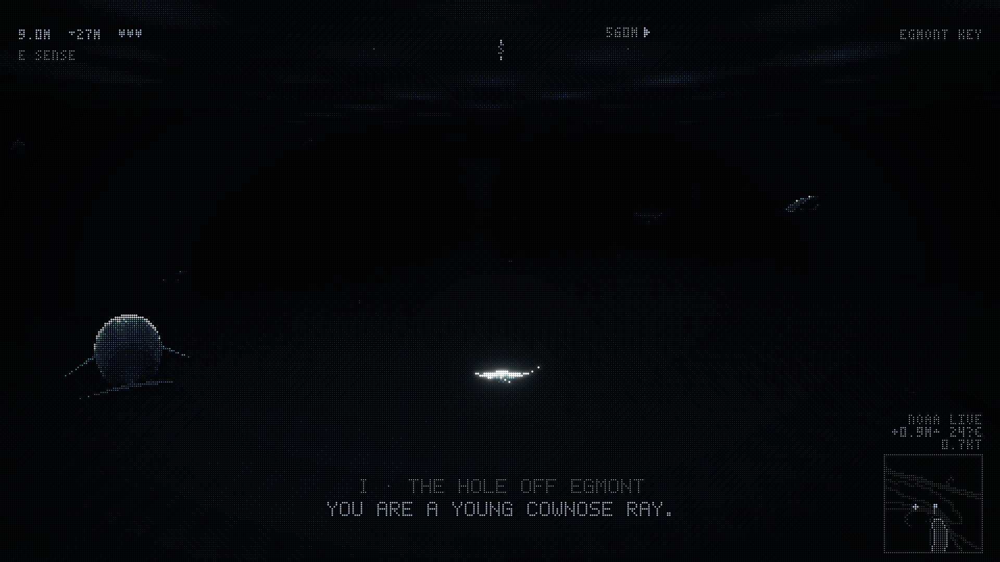
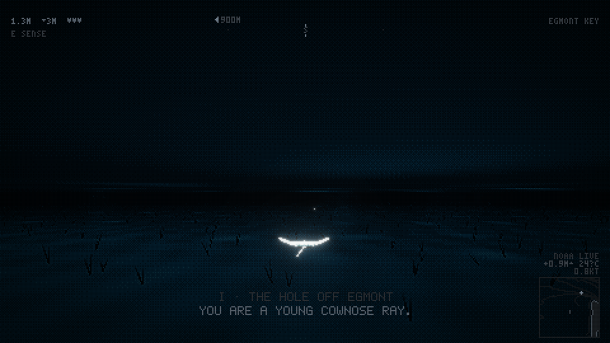
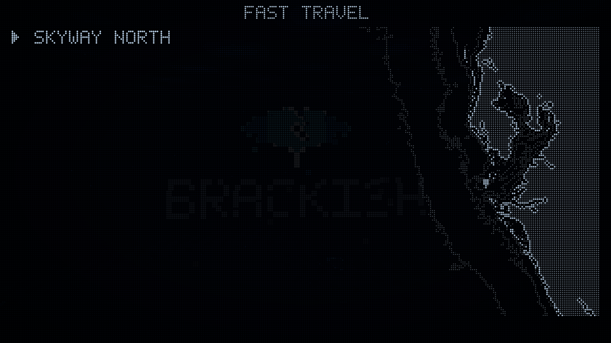
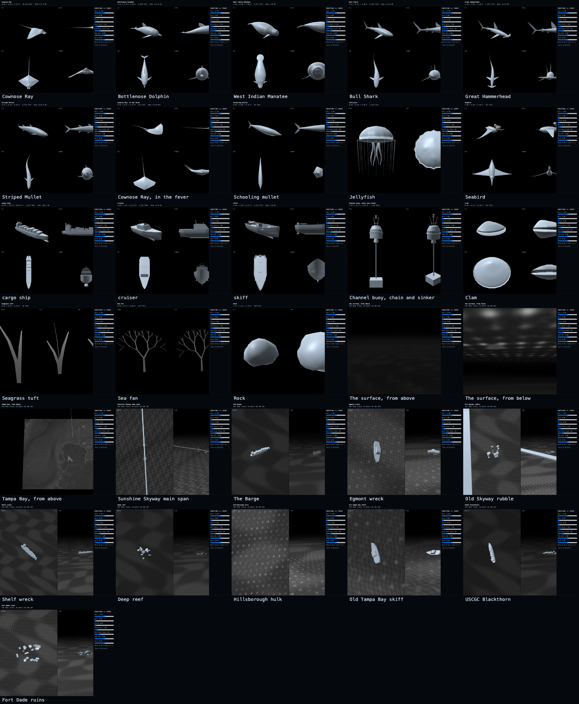

# Brackish

Play it at https://brackishgames.github.io/brackish/

You are an animal in Tampa Bay. The whole thing is drawn the way the old Pioneer car stereos drew
their dolphin screensaver: cyan and blue dots on black, pale readouts lit on the same grid.

## The bay

The bay is real and to scale. One unit is one metre. Depths come from the NOAA NCEI DEM mosaic, which the page
downloads the first time it runs and keeps in the browser after that. The ship channel is 12.5 m, the hole off the
north tip of Egmont Key is 25 m, and the Gulf reaches 30 m about 50 km out. Tide, water temperature and tidal currents
come live from NOAA CO-OPS (St. Petersburg and 15 current stations). Bridges are pulled from OpenStreetMap, with the
Skyway, Gandy, Howard Frankland and Courtney Campbell built in for when that request fails. Each place you reach for
the first time tells you one true thing about it: the Skyway in 1980, the Blackthorn, Fort Dade, Big Bend's warm water.

## The story

Nine chapters across four bodies, each moving at the real animal's speed: a cownose ray finds the fever off Egmont and
follows it into the Gulf; a bottlenose dolphin swims beside one of its pod and leaps with it; a bull shark feeds in
Hillsborough Bay at night; a manatee makes for the warm water at Apollo Beach. Then you are the ray again, in the pass
where you began, at dawn. After that you can swim anywhere as any of them.

The bay is not on your side. A shark that finds a ray alone, or at the ragged edge of the fever, stays on you until you
lose it: get far away, or deep into the fever. Hammerheads follow the migration and pin rays to the sand. Hulls hit the
top few metres and their wash throws you about astern; you hear a ship's slow thrum long before you see it. At night,
giggers pole the flats with a light on the bottom, and in the light you shine. Dolphins and manatees need air.

## Playing

Press Enter or click and the game goes full screen and takes the mouse. Play with two hands: W and S swim
faster and slower, A and D (or ← →) turn, ↑ rises and ↓ dives (K and J too). With a hand on the mouse, the mouse steers, Space rises, Q dives, and the right button looks around. Let go of a
rise or a dive and the nose comes back level. Shift is a burst: five seconds flat out, at a little over twice the animal's
real sprint, back in about two. Strong tide is something else: it carries you, and the readout says TIDE and which way. E is the ability: a ray senses clams buried in the sand, a dolphin
echolocates, a shark lunges, a manatee takes a breath. Tab cycles the bodies you have been and M opens the map for fast
travel. Esc or P pauses: fast travel, the journal of places you've found, how to swim, restart the chapter, and settings (sound, controls, comfort, feedback, a new game).

A controller works over USB or Bluetooth (Xbox, PlayStation, Switch Pro): left stick steers, RT swims, A bursts, X is the
ability, the right stick looks around, START pauses. A phone plays sideways: tilt it like a wheel to turn, tip the top away
to dive or toward you to rise, and hold a thumb anywhere to burst (TILT STEERING in settings turns tilt off for a drag
stick). F, or *Send feedback* in settings, sends us a note from where you are.

The screen is laid out by what each thing is about. Top left is you: your hearts and the burst you have left, your speed in mph with the knots beside it,
your ability on its key, then the tide on you, air and the hunt when they matter. Top middle is where you're going: the
compass, the goal and its distance on it, and the place you're in. The left edge is the depth: the surface at the top, the
bottom under you at the foot, and how deep you are riding beside you. A bottom corner holds the chart and the live NOAA
water level and temperature. Bottom middle is what you hear and what you're told, the sounds leaning to the side they came
from. It is quiet by default: each part comes up only while it has something to tell you (a hit, a burst, a turn away from
the goal, a new place, rising or diving, the bottom close) and goes back down a few seconds later, so calm water is just the
bay. Depth reads in the stereo's own seven-segment digits. Hunted or short of air, the edges of the screen close in. HUD in
settings switches it to always on. Clams give a heart back, and a well-fed animal carries up to five. At a moment worth keeping
(a wreck or landmark close by, inside the fever, a leap together, the surface at dawn) a prompt appears and O opens photo
mode (O works anywhere): the bay stops, the screen clears, and you can orbit, zoom, slide the lens and change it (Q E) before Enter saves a picture.

Settings cover volume (with ambience and effects apart), every key (CONTROLS), mouse speed, invert Y, turn speed, large
text, the HUD (quiet or always on), opt-in crash reports and sound captions, which show the sounds that matter (an engine, a shark's pressure wave, fish scattering)
on the side they came from. COMFORT holds what keeps the camera from making anyone queasy: field of view, horizon tilt,
camera sway, speed effects, a comfort vignette that steadies the edges in fast motion, screen shake, hit flash, and
flicker (never faster than 2.5 changes a second, and none when off). If your system asks for reduced motion, they all
start gentle. The game saves as you go and picks up where you left off.

## Running it locally

`node tools/serve.mjs` and open `localhost:8000`: it tells the browser never to keep an old copy, so an edit always
shows. There is no build step and nothing loads from anyone else's servers: three.js is in `vendor/` and the depths are in
`data/`. The live tide, temperature and currents still come from NOAA, and the bridges from OpenStreetMap, but the game
plays without them. On your own machine `?dev` opens every place and body, `?dev&clock=22` sets the hour, F3 shows the
world's state and `[` `]` slow time down or speed it up; `?seed=7` replays a run exactly. The published site ignores all
of that, and dev mode never touches your save. The page's security policy allows only this site and those data services.

## Pictures and models

`npm run shot` takes every scene (the title, swimming, a burst, the surface, night, the menus, photo mode, a phone) from the same seed into `.shots/`, with all of them on one `sheet.png`. `node tools/shot.mjs surface burst` takes just those, `--list` shows them, and `--at 27.62,-82.65,8 --clock 22 --js "P.hp = 1"` shoots any spot at any hour. It says so if the page logged an error or the canvas doesn't fit the window.

[Every model in the game](models/README.md) is listed with its size and triangle count, and each opens in GitHub's 3D viewer. `npm run specimens` rewrites that page, its STL files, `models/specimens.json` and the picture below from the code that builds them for the bay, and flags any model far from its real size. To turn one over on the game's own display: `localhost:8000/?dev&specimens` (drag, wheel, ← →, F for the wires).

## Testing

`npm install` once, then `npm test`: lint, unit tests, and the game played by a script.

- `npm run lint` checks every module's imports and load order, then lints every module on its own: a name it uses without importing is an error.
- `npm run test:unit` covers the pure logic in `src/lib/` (map frame, depths format, text wrap, tilt, saves, collision,
  feedback reports) and the feedback Worker.
- `npm run test:game` opens the game in headless Chrome at `?test`, where the world only moves when a test steps it, and
  plays it: cruising, the burst, levelling out, turning, the tide, running into a pier, pausing, comfort settings,
  feedback, rebinding, the shapes in the murk, deep water, the echo, a controller, and a phone held both ways. Nothing in a
  test sleeps: it waits for the game's own events or for a condition to come true. `node tests/game.mjs burst` runs one.
  `SLOW=4 npm run test:game` plays on a machine four times slower, which is how races show up before CI finds them.

`window.__game` (in `?test` and `?dev`) is the whole interface: `start()`, `setInput({ turn, climb, throttle, burst })`,
`step(frames)`, `state()`, `teleport(lat, lon, depth)`. Every pull request and every deploy runs all of it
(`.github/workflows/test.yml`); nothing ships that fails.

## Feedback

The game files feedback as GitHub issues, with the note and what the game knew at that moment. Out of the box it opens a
filled-in new-issue page; deploy the small Worker in `tools/feedback-worker/` (its README has the four steps) and it posts
straight from the game.

## Releases

The game is in beta, and every release is a pre-release: `v0.1.0-beta.1`, `v0.1.0-beta.2`, and on. [release-please](https://github.com/googleapis/release-please)
reads the commit messages on `main` and keeps one release PR open with the next version and its changelog; merging it
tags the release and stamps the version into `index.html`, where the title screen shows it. Commit messages follow
[Conventional Commits](https://www.conventionalcommits.org/): `feat: …` for something new, `fix: …` for a repair,
anything else (`docs:`, `chore:`, `refactor:`) stays out of the changelog. To leave beta, set `"versioning": "default"`
and drop `"prerelease"` in `release-please-config.json`, then commit with a `Release-As: 1.0.0` footer.

## Code

`index.html` holds the markup and styles; `src/main.js` imports every module in layer order, lowest first, then boots the
bay. Each layer only builds on the ones below it:

| Layer | Modules |
|---|---|
| `src/lib/` | pure logic with no game state, unit-tested: `rng`, `geo` (the metric frame), `text` (wrapping), `tiff`, `dem` (the shipped depths format), `tilt`, `save` (signing, versions), `collide`, `feedback` (reports) |
| `src/core/` | what everything stands on: `env` (device, modes, build), `random` (the seed and `rand`), `tune` (every number that decides how it feels and how long things last), `events`, `settings`, `screen` (full screen, orientation), `space` (directions, placement, scratch values) |
| `src/render/` | `display` (the renderer and the dot-matrix post), `materials` (the shared shading and the animated body material), `effects` (sky, water, light shafts, particles) |
| `src/world/` | `time` (the hour), `geo` (the depths, NOAA, the places, the `Bay` API), `seafloor`, `structures`, `seabed` |
| `src/actors/` | `creatures` (species and bodies), `player` (the body you are, its abilities, being hurt), `wildlife` (who you meet, sharks that hunt, shapes that pass), `fever`, `life` (jellies, food, mullet, birds), `boats` |
| `src/systems/` | `input` (the input snapshot, keys and bindings, mouse, controller, the pause menu, photo mode), `audio`, `save`, `story` |
| `src/ui/` | `hud` (readouts, the map, the story line), `panel` (the dot font and every word on screen), `logo`, `touch` (touch and tilt), `feedback` |
| `src/app/` | `frame` (world steps and the frame, the player's step, the camera), `testing` (`window.__game` and the dev readout), `boot` |

Each module imports what it uses: `npm run imports` writes those lines from what the code actually reads, and the check
in `npm run lint` fails if any import is missing or extra, or if a module uses something while it is loading from a
module that can import it back (those uses go in an init function that boot calls). Every shared variable has one owner,
the module that changes it; anything else asks that module. The world moves in fixed slices of time and every roll goes
through one seeded `rand()`. Nothing waits on a guess: a step that follows another is called when that one has happened
(a fade reaching black, a chapter begun, full screen granted). On your own machine (`?test`, `?dev`) every module's
exports are reachable from the console, read-only; the published game puts nothing on `window`.

`node tools/export-model.mjs [lat lon radius name]` exports what the game built around a point (structures and the real
seabed) as a `.glb`, and `tools/inspect/?model=name` (on `node tools/serve.mjs`) shows it lit plainly, with sea level,
parts you can hide and the height of whatever you point at; `&cam=x,y,z&look=x,y,z` opens on a view. The bridges' heights
come from `src/world/bridges.js`, which cites its sources and marks what is estimated. `tools/fetch-dem.mjs` fetches the depths from NOAA again (only if the tile bounds change), `tools/vendor-three.mjs`
copies a three.js version into `vendor/`, and `tools/marks.py` redraws the logo, org avatar and share card in `brand/`.
