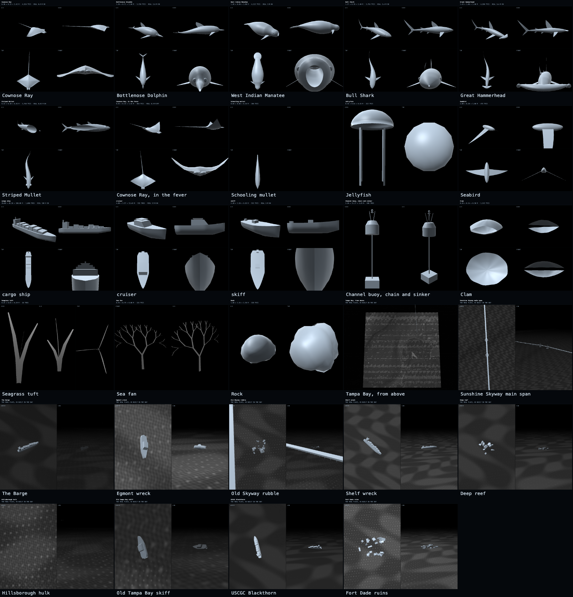
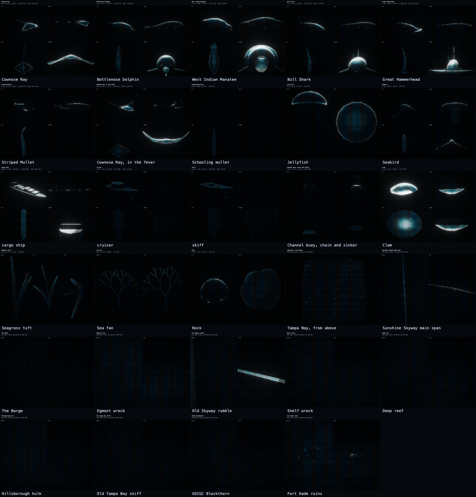

# The models

Every model in the game, built by the code that builds it for the bay. Open any name to turn it in GitHub's 3D viewer. Written by `npm run specimens`; don't edit by hand.

And as the player sees them:

| Model | Kind | Size (x × y × z) | Real size (m) | Triangles |
|---|---|---|---|---|
| [Cownose Ray](cownose.stl) | animals | 0.90 × 0.13 × 1.42 m | 0.9 | 4,524 |
| [Bottlenose Dolphin](dolphin.stl) | animals | 1.16 × 0.71 × 2.60 m | 2.6 | 3,720 |
| [West Indian Manatee](manatee.stl) | animals | 1.26 × 0.80 × 3.00 m | 3 | 4,112 |
| [Bull Shark](bull.stl) | animals | 1.17 × 0.78 × 2.40 m | 2.4 | 3,756 |
| [Great Hammerhead](hammer.stl) | animals | 1.43 × 1.08 × 3.40 m | 3.4 | 4,260 |
| [Striped Mullet](mullet.stl) | animals | 0.13 × 0.10 × 0.45 m | 0.45 | 3,748 |
| [Cownose Ray, in the fever](fever-ray.stl) | animals | 0.85 × 0.13 × 1.42 m | 0.9 | 964 |
| [Schooling mullet](school-fish.stl) | animals | 0.04 × 0.08 × 0.34 m |  | 104 |
| [Jellyfish](jelly.stl) | animals | 0.44 × 0.64 × 0.43 m |  | 222 |
| [Seabird](bird.stl) | animals | 2.00 × 0.20 × 1.00 m |  | 476 |
| [cargo ship](ship.stl) | boats | 28.00 × 46.56 × 180.00 m | 180 | 1,060 |
| [cruiser](cruiser.stl) | boats | 4.00 × 3.97 × 12.48 m | 12 | 932 |
| [skiff](skiff.stl) | boats | 2.20 × 1.58 × 6.03 m | 6 | 932 |
| [Channel buoy, chain and sinker](buoy.stl) | structures | 2.20 × 12.17 × 2.20 m |  | 688 |
| [Clam](clam.stl) | plants and the bottom | 0.36 × 0.14 × 0.30 m |  | 1,512 |
| [Seagrass tuft](seagrass.stl) | plants and the bottom | 0.25 × 0.65 × 0.29 m |  | 18 |
| [Sea fan](sea-fan.stl) | plants and the bottom | 0.95 × 0.79 × 0.00 m |  | 126 |
| [Rock](rock.stl) | plants and the bottom | 1.68 × 1.34 × 1.76 m |  | 320 |

The last rows of the picture are real places, as built in the bay. To see any of them on the game's own display, from four angles at once: `node tools/serve.mjs`, then `localhost:8000/?dev&specimens`.
